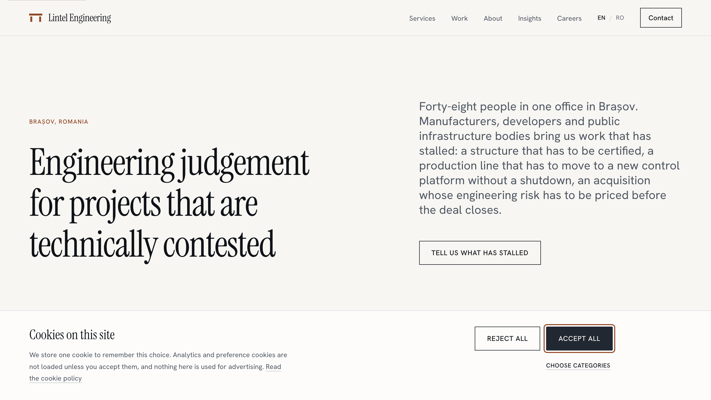

# Lintel Engineering

A bilingual (English / Romanian) corporate website for an engineering consultancy, built as a demonstration of production front-end practice: localised routing without middleware, a hand-built design system, hash-based CSP on a statically generated site, and a CI pipeline that fails the build on performance and accessibility regressions.

**Live:** https://lintel-engineering.vercel.app
**CI:** (https://github.com/deandre25/lintel-engineering/actions/workflows/ci.yml/badge.svg)]

> Lintel Engineering is a fictional company. The staff, case studies, client engagements and registration numbers on this site are invented. The site exists as an engineering portfolio piece and is not a real business.



---

## Measured results

Lighthouse, mobile profile, throttled, median of five runs per locale, taken from `main`:

| Locale | Performance | Accessibility | Best Practices | SEO | LCP    | CLS   | TBT   |
| ------ | ----------- | ------------- | -------------- | --- | ------ | ----- | ----- |
| `/en`  | 100         | 100           | 100            | 100 | 919 ms | 0.000 | 47 ms |
| `/ro`  | 100         | 100           | 100            | 100 | 913 ms | 0.000 | 36 ms |

First-load JavaScript, gzipped:

| Route group                       | Size     | Gate   |
| --------------------------------- | -------- | ------ |
| Home (`/en`, `/ro`)               | 138.9 KB | 140 KB |
| Service and content pages         | 139.5 KB | 185 KB |
| Contact (`react-hook-form` + Zod) | 179.5 KB | 185 KB |

Other figures:

- 50 routes, all prerendered, 25 per locale
- 56 unit tests, 55 browser tests (end-to-end, axe, overflow)
- 0 axe violations across 11 page templates in both locales
- 19 colour pairings asserted against the token source at build time
- 86 JSON-LD blocks validated against the published schema.org vocabulary
- 54 inline-script hashes in the Content-Security-Policy, ~3.4 KB of header
- 28 Open Graph images emitted as static PNGs at build
- 0 TypeScript errors under `strict` with `noUncheckedIndexedAccess`
- 0 occurrences of `any` in source

Every figure above is enforced in CI. The build fails if Lighthouse drops below threshold, if first-load JavaScript exceeds its budget, if axe finds a violation, if a contrast pairing falls below its minimum, or if a JSON-LD property is used outside its schema.org domain.

---

## Stack, and why

| Concern          | Choice                                                             | Reason                                                                                                                                                                                            |
| ---------------- | ------------------------------------------------------------------ | ------------------------------------------------------------------------------------------------------------------------------------------------------------------------------------------------- |
| Framework        | Next.js 16 (App Router), fully static                              | The site has no server-side state. Every route is prerendered; nothing is fetched at request time.                                                                                                |
| Language         | TypeScript 6, `strict` + `noUncheckedIndexedAccess`                | Type-aware linting is what enforces zero `any`. The TypeScript version is pinned below 6.1 because `typescript-eslint` requires it, and type-aware linting was worth more than the newer release. |
| Styling          | Tailwind 4, theme driven by CSS custom properties                  | Tailwind's default colour, type and spacing ramps are **cleared, not extended**, so no unconsidered default can reach the page. Every token has a single definition in `src/styles/tokens.css`.   |
| Components       | Hand-written                                                       | No component library. Building the primitives was the point; installing them would have demonstrated nothing.                                                                                     |
| i18n             | `next-intl`, no middleware                                         | See _Localised slugs without a runtime_ below.                                                                                                                                                    |
| Content          | Typed modules and MDX, validated by Zod at build                   | A malformed content file fails the build rather than rendering blank.                                                                                                                             |
| Forms            | `react-hook-form` + Zod, one schema shared with the submit handler | Zod runs **jitless**: it normally compiles validators through `new Function`, which would require `script-src 'unsafe-eval'` and defeat the hash-based CSP.                                       |
| Unit tests       | Vitest + React Testing Library                                     | —                                                                                                                                                                                                 |
| Browser tests    | Playwright + `@axe-core/playwright`                                | —                                                                                                                                                                                                 |
| CI               | GitHub Actions, 6 jobs                                             | —                                                                                                                                                                                                 |
| Performance gate | Lighthouse CI with assertions                                      | A threshold that does not fail a build is a suggestion.                                                                                                                                           |
| Fonts            | Instrument Serif + Hanken Grotesk via `next/font`, self-hosted     | Subsets include `latin`, `latin-ext` **and `vietnamese`** — see the typography finding below.                                                                                                     |
| Analytics        | Plausible, loaded only after consent                               | —                                                                                                                                                                                                 |
| Hosting          | Vercel                                                             | —                                                                                                                                                                                                 |

---

## Architecture

```
src/
  app/
    [locale]/            the root layout — locale is a typed root param
      page.tsx           home
      services/          index + 6 service pages
      work/              index + 4 case studies
      insights/          index + 3 MDX articles
      about/  contact/  careers/
      privacy/  cookies/  terms/  legal-notice/
      styleguide/        noindex, excluded from the sitemap by a registry flag
      not-found.tsx      localised 404
    not-found.tsx        global 404 — see Known limitations
    sitemap.ts  robots.ts  opengraph-image.tsx
  components/
    sections/            Hero, Features, CaseStudyGrid, FAQ, CTA, TeamGrid, ContactForm…
    ui/                  Button, ButtonLink, Prose, Field, TextInput, Textarea,
                         Select, Disclosure, Breadcrumb, Container, Link
    graphics/            hand-authored SVG — no photography anywhere on the site
  content/
    company.ts           single source for headcount, disciplines, locations
    en/  ro/             typed content modules, Zod-validated
  lib/
    routing.ts           single owner of every path in the project
    seo.ts  schema.ts
  styles/
    tokens.css           every colour, type step and spacing value
messages/                en.json  ro.json — 111 UI keys each
scripts/
  validate-jsonld.mjs    schema.org vocabulary check, domain-aware
```

### Localised slugs without a runtime

Romanian URLs use Romanian words: `/ro/servicii/inginerie-structurala`, not `/ro/services/structural-engineering`. `next-intl`'s `pathnames` feature delivers this through middleware, and middleware is a request-time runtime this project does not have.

Instead, `src/lib/routing.ts` is the single owner of every path, and `next.config.ts` derives build-time rewrites from it. One file defines a route; the rewrites, the sitemap, the `hreflang` alternates and the breadcrumbs all read from it. Adding a locale or a page means editing one file.

The head `hreflang` links and the sitemap's `xhtml:link` entries are generated from the same function and cross-checked byte-for-byte, because two code paths emitting the same facts is a latent bug rather than a style preference.

### Content-Security-Policy without nonces

A nonce-based policy needs a fresh value per request, and therefore a runtime. On a statically generated site the inline scripts are known at build time, so the policy uses SHA-256 hashes instead.

**The policy ships as markup, per page, not as a header.** A header cannot carry it: `script-src` must name the hash of every inline script that may execute, and the host's build emits 1,158 inline scripts across 54 pages — 649 distinct, 35 KB of hashes, against a 32 KB limit on the host's entire routing configuration. A page only executes its own scripts, so `scripts/generate-csp.mjs` injects a `<meta http-equiv="Content-Security-Policy">` into each page's `<head>` after the build, naming that page's hashes alone: 417 bytes here, about 2.3 KB on the host. `frame-ancestors` stays in a header, because a meta policy ignores it and it takes no hashes.

The hashes are computed from the exact bytes of the file they are written into. That matters more than it sounds: the same page has 3 inline scripts on this machine and about 21 on the host, because how the streamed payload is flushed is environment-dependent. Three earlier attempts — building twice, committing the list, patching the routing manifest — all failed because each compared one environment's output to another's. See finding 5 below.

Two more things made that work:

- `generateBuildId` is derived from the commit. Next's default build id is random per build, which made every page's hydration payload — and therefore its hash — change on each build. A build that does not reproduce also makes "the deployed artefact was built from this commit" unverifiable, so this is recorded as a reproducibility decision, not a CSP detail.
- `application/ld+json` blocks are excluded from the hash set. A script element whose type is not a JavaScript MIME type never reaches the CSP check, because the browser abandons it earlier when preparing the script. Including them would have meant 140 hashes and 8 KB of header instead of 54 and 3.4 KB.

The analytics host is **deliberately allowed** in the policy. If it were blocked, the cookie gate would appear to work for the wrong reason and a regression in the gate would be invisible. The consent test asserts on network requests, not on a flag:

| Action         | Requests to the analytics host                |
| -------------- | --------------------------------------------- |
| No choice made | 0                                             |
| Reject all     | 0, including after navigating to another page |
| Accept all     | 2                                             |

### Accessibility

Zero axe violations across every page template in both locales, checked in CI. Beyond the automated rules:

- Every text and UI colour pairing is asserted against `tokens.css` itself rather than a duplicated table, so the figures printed in the styleguide are the asserted ones. Its first run caught a real failure: a footer disclosure at 3.4:1.
- Disabled controls use inert tokens, not `opacity`. Opacity composites label and fill together; the primary button measured about 3.1:1 and read as a translucent block. It is now a `--ink-200` fill with an `--ink-600` label at 7.1:1. WCAG exempts inactive controls, so axe never flagged this — it was found by checking every pairing rather than by running the checker.
- The mobile navigation traps focus while open, closes on `Escape`, and returns focus to its trigger. The disclosure component unmounts its panel when closed, so links inside cannot be tabbed to while invisible.
- `prefers-reduced-motion` is honoured and tested.

---

## How this project was built

The project ran in eight phases against a written brief, with a review gate at the end of each. Implementation was AI-assisted — Claude Code, driven spec-first: specification, then plan, then tasks — with verification at every gate by the author. The brief, the gates and the review record are the reason the project has a `DECISIONS.md` with a dated entry for every non-obvious choice.

The most useful thing to come out of it was not a feature. Five times, a defect survived a passing check because **the instrument was wrong, not the system**:

**1. A silent edit that tests could not catch.** A string replacement in the button styles failed to match, because Prettier had already reflowed the source. The removal applied and the replacement did not, so for several minutes the buttons had no disabled styling at all. Found by screenshotting the page and reading the rendered class list rather than trusting the edit's result. The root cause recurred later in the same form, and was then fixed as a working practice: match against the file as it currently stands, and abort loudly on a miss instead of writing a no-op.

**2. `curl` reports the shell, not the page.** The 404 pages appeared to be missing `html lang` on both the localised and the global boundary. They were not. A 404 body arrives as an RSC payload and renders on the client, so `curl` sees only the shell. Verified in a browser, the picture was different: the localised 404 carries `lang`, only the global shell does not. The same tool is the _correct_ instrument one phase later, for SEO, and for exactly the same reason — what matters there is precisely what a crawler sees without executing JavaScript.

**3. A performance delta that was a typography defect.** Romanian LCP measured consistently 150 ms slower than English — order-independent across five runs per locale, so not thermal drift. Two hypotheses were wrong. The cause: `document.fonts.check('17px "Hanken Grotesk"', 'ă')` returned `false`. Google places U+0102–0103 (Ă/ă) in the **`vietnamese`** subset, not `latin-ext`, so the face was never loading for that character and Romanian text was being set in two typefaces at once — Hanken Grotesk, plus the system sans for every `ă`. Half the site's content was mis-set, and 78 screenshots across 13 templates, 2 locales and 3 widths had not caught it: a single diacritic in a fallback face is below the resolution of visual review. The proof of cause was the cost of the fix — English rose from 758 ms to 919 ms while Romanian stayed at 913 ms. The delta did not disappear, it equalised.

**4. A green pipeline that was never running.** Five of six pull requests had no checks at all, because the workflow filtered on pull requests into `main` and the phases were a chain. Separately, `actions/upload-artifact@v4` skips hidden files by default and `.next` begins with a dot, so the build artefact had never once uploaded — while the build job passed, because it logged a warning rather than an error. A pipeline that looks green because it did not run is worse than a red one.

**5. A policy verified locally, and wrong in production.** Every CSP test passed against a local production build, and the deployed site had no working interactivity at all: nothing hydrated, because the served `script-src` named zero hashes. The cause was the one the hash approach is most exposed to — the hashes had been computed from a different build than the one being served. Confirmed by diffing the two hash lists in CI, where all 54 differed: chunk filenames are content-addressed per environment, so they appear inside the inline bootstrap, so every hash changes. The fix generates the policy during the deployed build rather than pinning environments to match. Four attempts at it failed for a single reason no local run could expose — on the host, the prerendered HTML is not where it is locally — which is why the script now searches in widening steps and logs which one found the pages. The lasting change is not the script but the check: `scripts/verify-deployment.mjs` runs against the live URL after every deploy and asserts the served policy names hashes, that no violation fires in a real browser, and that the consent control actually responds. It was written to reproduce this defect, it did, and it now blocks a release that would reintroduce it. A test suite that only ever runs against a build you made yourself cannot see this class of bug.

---

## Running it

[TODO: verify these script names against `package.json`]

```bash
npm ci
npm run dev          # http://localhost:3000/en

npm run typecheck    # tsc --noEmit
npm run lint
npm run test         # Vitest
npm run test:e2e     # Playwright: end-to-end, axe, overflow
npm run build
npm run lighthouse   # Lighthouse CI with assertions
```

`/en/styleguide` renders the type scale, the colour ramp with its measured contrast ratios, the spacing scale, the focus treatment and every component in every state. It is `noindex` and excluded from the sitemap by a flag in the route registry, so one change removes it from both.

### Adding a locale

1. Add the locale to `src/lib/routing.ts`, including the localised segment for each route.
2. Add `messages/<locale>.json`. Messages are statically imported with `satisfies Record<Locale, typeof en>`, so a key translated in one locale and not the other fails `tsc`.
3. Add `src/content/<locale>/`. The Zod schemas will reject anything missing.
4. Confirm the font subsets cover the new language's characters. This is not obvious — see finding 3 above.

No middleware, no route files and no rewrite rules need editing: `next.config.ts` derives them from the registry.

### Adding a service page

Add an entry to `src/lib/routing.ts` and a content module per locale. The page, the sitemap entry, the `hreflang` alternates, the breadcrumb, the JSON-LD `Service` node and the Open Graph image are all generated from those.

---

## Decisions and trade-offs

`DECISIONS.md` carries a dated entry for each. The ones that shaped the project:

- **Localised slugs through build-time rewrites rather than middleware.** Keeps every route static. Cost: `output: 'export'` is not available, because rewrites are not supported under it.
- **No `NextIntlClientProvider`.** The two client components take their strings as props, which keeps the ICU runtime and the message catalogue out of the browser. 11 KB saved, measured.
- **Hash-based CSP rather than a nonce.** No runtime, no `unsafe-inline`, no `unsafe-eval`. Cost: paths with no valid locale prefix cannot be covered — see Known limitations.
- **Two performance budgets rather than one.** The brief set the first-load budget for the landing page; the gate was applying it to all 50 routes, and the contact form legitimately exceeded it. The fix was to narrow the gate to the scope the brief specified, not to raise the number for everything.
- **Each CI job builds for itself** rather than configuring the artefact upload to include hidden files. Fewer moving parts, no size limits, about 30 seconds per job.
- **The Romanian version names the regulated roles it does not hold** — _verificator de proiecte atestat_, _expert tehnic atestat_, _auditor energetic autorizat_. Several Romanian terms for this kind of work are reserved by statute for state-attested roles, which the English equivalents are not. The Romanian therefore carries a sentence the English does not. That asymmetry is correct localisation, not drift.
- **No photography anywhere.** All imagery is hand-authored SVG — isometric structural schematics, sections, contour and grid patterns. Stock photography is the fastest way to make a site look fake, and this also removes every licensing question.

---

## Known limitations

- **The global 404 has no `lang` on `<html>`.** The root layout lives at `[locale]/layout.tsx`, which is what makes `locale` a typed root param and keeps every route static. Next therefore renders the global 404 in its own shell and emits its own `<html>`. The page content is marked at block level, so no text inherits language from the document and a screen reader reads every string in the correct language; the defect is formal. Scope is inbound links with no valid locale prefix, since every internal link is generated from the route registry. The test asserts the block-level attributes and marks the document-level rule as a known failure, so it will fail if the behaviour changes in either direction.
- **Unknown slugs under a locale answer with the global 404, not the localised one.** `dynamicParams = false` is required for the hash-based CSP, because an on-request page embeds the requested URL in its hydration payload and therefore cannot be hash-covered. The alternative was a localised 404 whose hydration CSP blocks, leaving a blank page. A bare but working page beats a blank one.
- **The contact page is 179.5 KB first-load**, against 138.9 KB elsewhere. `react-hook-form`, its resolver and Zod account for the difference. A lighter form is possible; this one was specified.
- **The Romanian copy is an adaptation, not a translation**, written with idiom replaced rather than calqued where it would not carry. It should be reviewed by a native speaker before any real use.

---

## Licence and credits

See [CREDITS.md](CREDITS.md). The code is available for reading and reference; the content is written for a fictional company and is not reusable as business copy.
